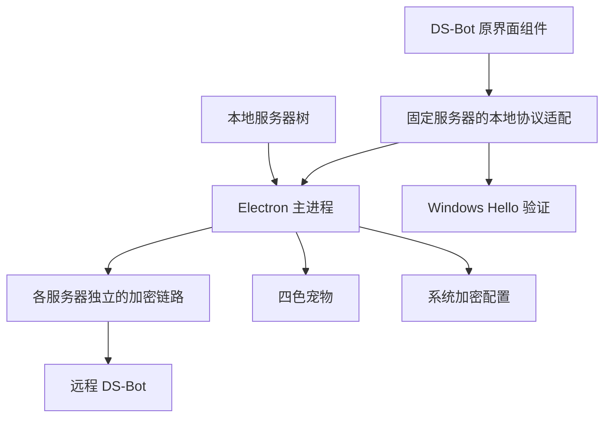
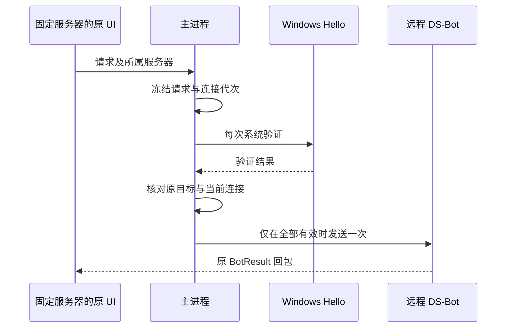
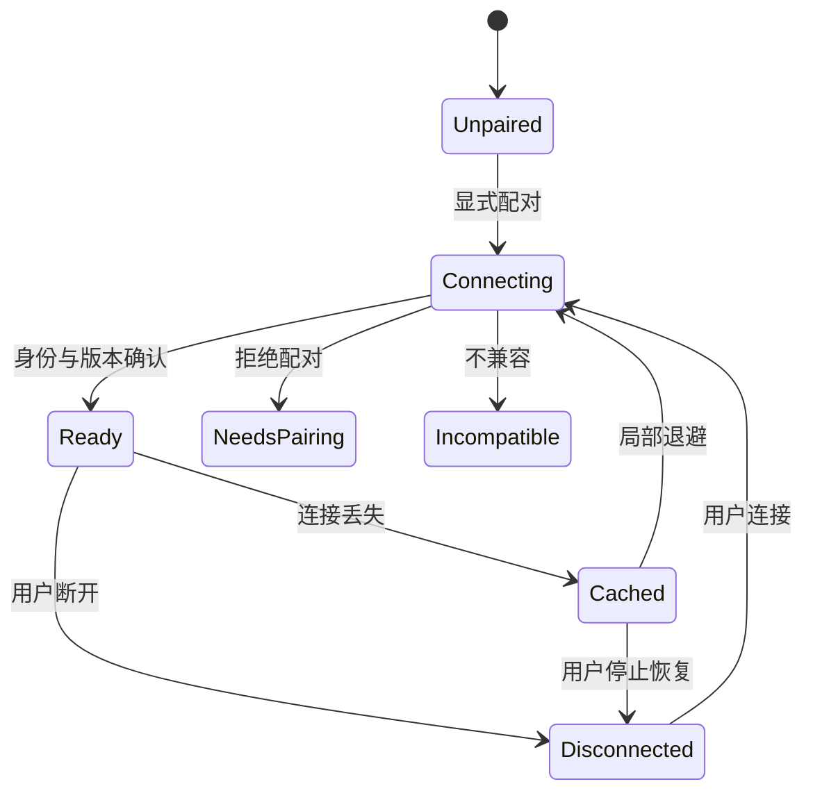
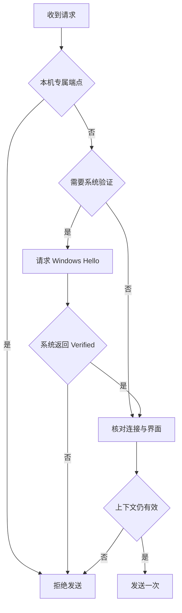
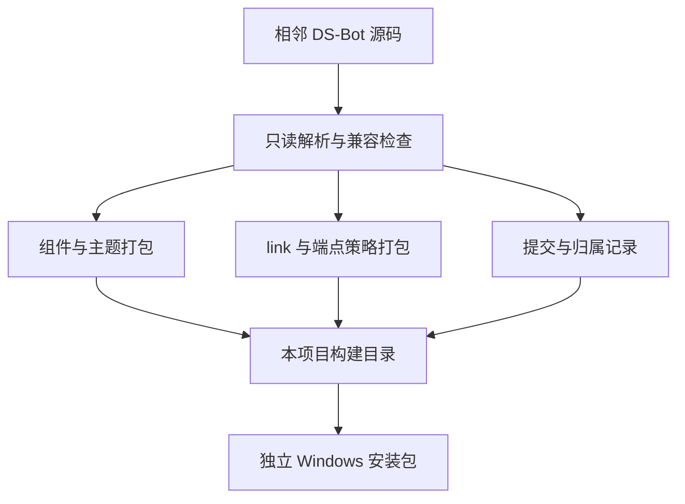

# DSBotDeck 远程桌面客户端 - Plan

## Goal Capsule

- 目标：新增只管理远程 DS-Bot 的桌面客户端，保留 DS-Bot 原界面，增加多服务器树和四色宠物。
- 权威：用户确认的产品边界优先；本方案规定接入机制；上游源码只读。
- 工作位置：本项目；相邻的 `../DS-Bot/` 与 `../DshDeck/` 不产生修改。
- 执行方式：当前会话内实现，不调用外部模型，不自动提交或发布。
- 验证边界：代理只做静态检查与代码审查，不安装依赖、编译、运行程序或测试；实际验证由用户执行。
- 停止条件：上游协议或权限不允许某项远程能力时报告原因，不修改服务器、不绕过鉴权。
- 交付边界：源代码与静态检查完成不等于构建、系统验证或远程连接已通过。

---

## Product Contract

### Summary

DSBotDeck 是 DS-Bot 的独立远程桌面外壳。
聊天、详情和设置沿用上游组件与样式。
左侧导航改为多服务器树，宠物汇总关注对象的真实任务状态。

### Problem Frame

上游现有桌面应用会启动自己的 DSH 和本地团队，不符合只管理远程团队的需求。
修改上游文件又会增加同步上游的冲突。
另画一套界面会产生长期功能和视觉差异。

### Requirements

**独立性与界面**

- R1. 所有新增文件属于本项目，上游源码仅在构建时读取。
- R2. 聊天、Bot 详情、设置、主题和动效复用 DS-Bot 原有实现，仅新增服务器导航与宠物外壳。
- R3. 客户端不启动或打包 DSH、Agent、终端、Python、Office 或本地 Bot 服务。

**连接与管理**

- R4. 使用手机端同一套加密配对、主机身份核对、Relay 和 Bot RPC 协议。
- R5. 覆盖手机链路允许的远程管理能力，包括敏感设置；敏感请求每次通过真实系统验证后才发送。
- R6. 保留上游的本机权限边界，拒绝远程设备配对管理和 MCP 接入配置等上游禁止的操作。
- R7. 每台服务器的设备身份、界面存储和请求上下文隔离，切换服务器不能改变已在途请求的目标。
- R8. 断线、超时、取消和验证失败均不自动重发写入请求，旧连接的迟到事件不得覆盖新连接。

**导航与宠物**

- R9. 树形导航显示服务器、上游分组、Bot 与群聊，并支持搜索、折叠、连接控制、设置入口和关注切换。
- R10. 四色灯分别表示运行、待交互、明确失败和完成待查看，颜色来自远程事实而不是网络连接状态。
- R11. 缓存仍可显示，但标明状态待确认并停止运行动画；停止和中断不自动算明确失败。
- R12. 宠物主体可拖动，锁定只穿透主体；状态灯与气泡仍可交互，气泡仅由状态灯打开并在离开两者十秒后关闭。

**本机安全与交付**

- R13. 配对私钥与 Relay 令牌只在主进程使用，以系统加密存储保存，不以明文降级，不进入渲染进程或日志。
- R14. 首版针对 Windows 10/11，Windows Hello 未就绪或用户取消时敏感请求不发送。
- R15. 关闭客户端窗口不停止远程 Bot；退出只关闭本机连接，支持托盘恢复窗口。
- R16. 新文件使用 UTF-8，保留上游许可与归属，提供静态检查和用户验收说明。

### Key Decisions

- 完整远程管理而非纯监控或日常管理子集，Governs R5、R6。（session-settled: user-directed — chosen over monitoring-only or reduced management: 用户选择包含敏感设置的完整版本。）
- 原有 UI 而非重新绘制管理界面，Governs R2。（session-settled: user-approved — chosen over a separate UI fork: 用户要求界面与 DS-Bot 一致，并确认只读构建复用方案。）
- 系统验证而非普通确认框，Governs R5、R14。（session-settled: user-approved — chosen over confirmation-only gating: 用户确认没有系统验证就不发送敏感请求。）

### Acceptance Examples

- AE1. 添加两台使用同一个 Relay 的服务器后，两者同时保持自己的连接；切换界面不串团队和已读状态。Covers R4、R7、R9。
- AE2. 修改远程模型密钥时出现 Windows Hello；取消验证后服务器没有收到该请求。Covers R5、R13、R14。
- AE3. 验证期间切换服务器或断线，旧请求作废，不能借验证结果给另一台服务器发请求。Covers R7、R8。
- AE4. 断线后仍保留当前内容和灯，但显示缓存、停止动画；网络失败本身不增加红灯。Covers R10、R11。
- AE5. 完成结果首次进入视野后清除蓝灯；启动时已有的旧结果不全部算新完成。Covers R10。
- AE6. 锁定宠物后主体穿透，灯和气泡可操作；悬停主体不打开气泡。Covers R12。
- AE7. 重新构建读取新的上游组件，两个既有仓库仍无文件变更。Covers R1、R2、R16。

### Scope Boundaries

- 远程服务器已经安装并运行 DS-Bot，用户在服务器端开启手机访问和生成配对码。
- 不复制一个需要独立维护的上游 UI 分叉；本机只保存客户端自己的配置与界面偏好。
- 不把服务器的本地浏览器、系统窗口或工具运行环境移到客户端。
- 不新增云账号、中转服务器、SSH 管理、自动更新服务或跨平台系统验证。
- 宠物默认关注所有可显示的 Bot 和群聊，用户可逐项取消关注；此默认值是可调整的客户端偏好，不改变服务器团队。

---

## Planning Contract

### Key Technical Decisions

- KTD1. 构建只读引用上游 `app/ui/src` 与 `ds-bot/src/client`，替换独立界面入口和 DSH primitives 解析，不加载上游桌面 Host。Covers R1、R2、R3。（session-settled: user-approved — chosen over maintaining copied UI files: 通过重新构建跟随上游组件，原仓库不产生补丁。）
- KTD2. 每个已保存服务器拥有独立 X25519 身份、Relay 令牌和 Chromium partition，避免同 Relay 的重复设备注册互相挤掉。Covers R4、R7。
- KTD3. 主进程将本地自有 scheme 的 `api/bot` 和 `api/bot/feed` 接到手机链路；协议 handler 固定服务器和所属 WebContents，不启动 HTTP 服务。Covers R3、R4、R7、R13。
- KTD4. 复用上游敏感端点集合，并对未列为安全读取的其他宿主能力采用系统验证；本机专属端点拒绝发送。Covers R5、R6、R14。
- KTD5. 验证前冻结请求，验证后核对原连接代次与活动界面；失败结果返回原 UI 的 BotResult 契约。Covers R7、R8。
- KTD6. 同步按服务器单飞合并，使用 `hello`、`state`、feed 与 notices 补齐，冷启动以当前 notice 序号为基线。Covers R8、R10、R11。
- KTD7. 宠物采用 DS-Bot 自带 BotMark，不复制 DshDeck 或 pet-e 的 AGPL 代码与素材；交互规则重新实现。Covers R2、R12、R16。
- KTD8. Windows 系统验证通过系统自带 Windows PowerShell 的 WinRT Windows Hello 接口完成，只认可系统的 Verified 结果，不收集 PIN 或密码。Covers R5、R13、R14。
- KTD9. 系统加密不可用、保存损坏或读取身份失败时停止自动连接并说明原因，不生成替代身份覆盖原记录。Covers R4、R13。

### High-Level Technical Design

组件关系：



敏感请求顺序：



连接状态：



验证门禁：



只读构建数据流：



### Output Structure

```text
package.json
scripts/
  build.mjs
  upstream.mjs
src/
  shared/
  main/
  preload/
  renderer/
  remote/
native/
  windows-hello.ps1
tests/
docs/
  plans/
  verification/
LICENSE
NOTICE
```

### Risks and Dependencies

- 上游 `app/ui` 是已有但当前暂停打包的入口；构建前检查导出和接口，不能假定它经过当前发布版的实机验证。
- 接入依据是上游提交 `d104d9ca18d69a35460f14e15dff4d553181433a`，API 版本为 1；记录实际构建的上游提交。
- Windows Hello 的窗口与 WinRT 行为须在 Windows 10/11 实机验证；静态审查只证明失败时不发送请求，不能证明设备验证已经工作。
- 不在本轮联网获取 SDK 文档、下载依赖或检查线上 Relay；外部与运行时验证缺口在验收说明中保留。
- 上游新增的端点、组件导出或原生宿主能力可能需要调整本项目适配，不通过重写上游绕过。

---

## Implementation Units

### U1. 独立构建与归属

- **Goal:** 建立不启动本地 Host 的独立 Electron 项目，并只读打包上游 UI 与 link。
- **Requirements:** R1、R2、R3、R16；KTD1、KTD7。
- **Dependencies:** 无。
- **Files:** `package.json`、`tsconfig.json`、`electron-builder.yml`、`scripts/build.mjs`、`scripts/upstream.mjs`、`LICENSE`、`NOTICE`、`tests/upstream.test.ts`。
- **Approach:** 检查源目录、所需导出和依赖；本项目只输出自己的构建目录与来源记录。
- **Test scenarios:**
  - 上游路径正确时解析需要的源码；缺文件时指出文件，不写入上游。
  - 构建依赖列表不包含 DSH、Python、终端或本地插件宿主。
  - 来源记录保留实际提交与上游许可。
- **Verification:** 文件与导出静态核对；构建和打包由用户执行。

### U2. 身份与连接隔离

- **Goal:** 持久保存每台服务器自己的设备身份，维护加密连接与局部恢复。
- **Requirements:** R4、R7、R8、R13；KTD2、KTD6、KTD9；AE1。
- **Dependencies:** U1。
- **Files:** `src/shared/domain.ts`、`src/shared/validation.ts`、`src/main/vault.ts`、`src/main/link-factory.ts`、`src/main/server-connection.ts`、`src/main/server-manager.ts`、`tests/validation.test.ts`、`tests/vault.test.ts`、`tests/server-connection.test.ts`。
- **Approach:** 配对码只保留在一次连接的内存中；持久身份失败时不重置；连接代次隔离事件和在途操作。
- **Test scenarios:**
  - 同一 Relay 的两台服务器使用不同设备身份。
  - 旧连接的迟到回包不更新当前状态。
  - 被撤销的配对停止自动恢复；网络抖动保留缓存并局部退避。
  - 配对已经消费但后续读取失败时不丢失设备身份。
  - 加密不可用或文件损坏时不明文保存、不覆盖旧文件。
- **Verification:** 单飞、代次、身份生命周期和存储失败路径静态检查；测试定义保留供用户执行。

### U3. 系统验证与本地协议

- **Goal:** 原 UI 经固定服务器的协议 handler 使用远程接口，敏感请求受真实系统验证保护。
- **Requirements:** R5、R6、R7、R8、R14；KTD3、KTD4、KTD5、KTD8；AE2、AE3。
- **Dependencies:** U1、U2。
- **Files:** `src/shared/endpoint-policy.ts`、`src/main/native-unlock.ts`、`src/main/request-gate.ts`、`src/main/protocol.ts`、`native/windows-hello.ps1`、`tests/request-gate.test.ts`、`tests/protocol.test.ts`。
- **Approach:** 验证前冻结请求；验证后核对代次、原服务器和活动视图；协议保持原 BotResult 与 feed 契约。
- **Test scenarios:**
  - Verified 发送一次；取消、不可用与错误均不发送。
  - 验证期间切换服务器或重建连接，旧请求拒绝发送。
  - 伪造其他服务器来源和路径穿越被拒绝。
  - phone/MCP 本机端点不进入链路。
  - 写入超时不自动重发；feed 取消释放订阅。
- **Verification:** 请求链路与失败关闭静态审查，PowerShell 语法解析；系统验证与真实协议由用户验证。

### U4. 原 UI 接入与服务器树

- **Goal:** 用原组件显示聊天、详情和设置，并通过独立树选择目标。
- **Requirements:** R2、R9、R11；KTD1、KTD3；AE4、AE7。
- **Dependencies:** U1、U2、U3。
- **Files:** `src/main/content-views.ts`、`src/preload/shell.ts`、`src/preload/content.ts`、`src/renderer/main.js`、`src/renderer/app.js`、`src/renderer/shell.css`、`src/remote/app.js`、`src/remote/remote.css`、`tests/navigation.test.ts`。
- **Approach:** 各服务器页面独立 origin 和 partition；适配入口复用上游 createTeam、Chat、Overlays、HeaderPill 与样式，远程目录选择使用原 FolderMenu 的浏览模式。
- **Test scenarios:**
  - 切换服务器不复用另一台服务器的 localStorage 或请求目标。
  - Bot 自动换段后仍按 Bot 身份导航，不新增手动会话列表。
  - 缓存保持上下文，恢复后原 UI 重新读取。
  - 独立页面不能调用主窗口或宠物的特权 IPC。
- **Verification:** 组件、样式和通道绑定静态核对；真实渲染和完整管理动作由用户验收。

### U5. 四色宠物与窗口生命周期

- **Goal:** 汇总关注对象的真实状态，提供可拖动、可锁定的四色宠物与托盘窗口。
- **Requirements:** R10、R11、R12、R15；KTD6、KTD7；AE4、AE5、AE6。
- **Dependencies:** U2、U4。
- **Files:** `src/shared/task-model.ts`、`src/shared/pet-hover.ts`、`src/main/pet-window.ts`、`src/main/index.ts`、`src/preload/pet.ts`、`src/renderer/pet.js`、`src/renderer/pet.css`、`tests/task-model.test.ts`、`tests/pet-hover.test.ts`。
- **Approach:** 任务事实与网络状态分开；蓝灯按本机看到的结果确认；主体拖动按桌面坐标进行，交互区域区分主体、控件和透明区。
- **Test scenarios:**
  - 审批优先于运行；明确失败和完成分别计数。
  - 网络失败、停止与中断不直接生成红灯。
  - 冷启动旧结果不生成全量蓝灯；新结果成功展示后清除蓝灯。
  - 锁定主体穿透而控件仍交互，主体悬停不打开气泡。
  - 气泡离开十秒关闭，重返取消倒计时。
- **Verification:** 纯状态模型与拖动边界静态核对；系统托盘、穿透和拖动由用户实机验证。

### U6. 静态审查与用户验收

- **Goal:** 给出可复现的验证入口，检查没有改动既有仓库。
- **Requirements:** R1、R16。
- **Dependencies:** U1、U2、U3、U4、U5。
- **Files:** `README.md`、`AGENTS.md`、`docs/verification/remote-client.md`。
- **Test expectation:** 无新增运行行为；说明区分已检查与未运行。
- **Verification:** UTF-8、JSON、PowerShell 语法、相对引用、通道约束和既有仓库状态检查；记录尚未运行的类型、构建、测试和实机验收。

---

## Verification Contract

| 验证 | 执行者 | 成功信号 |
| --- | --- | --- |
| UTF-8、JSON、引用和 PowerShell 语法检查 | 代理 | 文件可解析，引用有效，没有越界写入 |
| 接入与安全代码审查 | 代理 | 请求目标固定，身份不泄露，验证失败不发送 |
| `npm run typecheck` | 用户 | TypeScript 严格检查通过 |
| `npm test` | 用户 | 已定义的纯模型和协议回归通过 |
| `npm run build` | 用户 | 原 UI、link 和独立壳可构建，来源记录正确 |
| `npm start` | 用户 | 客户端启动，未启动本地 DSH 或监听 HTTP 端口 |
| 两服务器、敏感设置、四色宠物验收 | 用户 | AE1–AE7 的实机行为成立 |
| `npm run dist` | 用户 | 独立安装包只包含客户端和必要归属 |

---

## Definition of Done

- 源代码交付：U1–U6 文件形成完整接入链路，完成静态检查和本地审查，两个既有仓库无文件改动。
- 运行证据：未执行的类型检查、编译、测试、系统验证和真实连接明确记录，不宣称通过。
- 功能验收：用户完成 Verification Contract 的运行项后才认定客户端可以正常使用。
- 清理：不留下废弃接入方案、临时服务或明文凭据，不为本轮创建后台运行进程。
