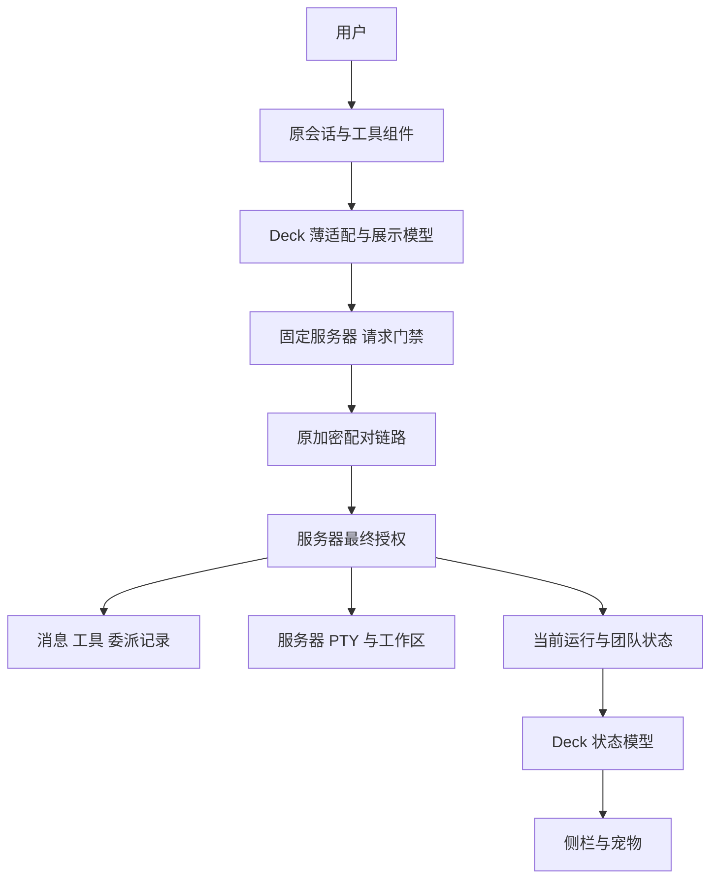
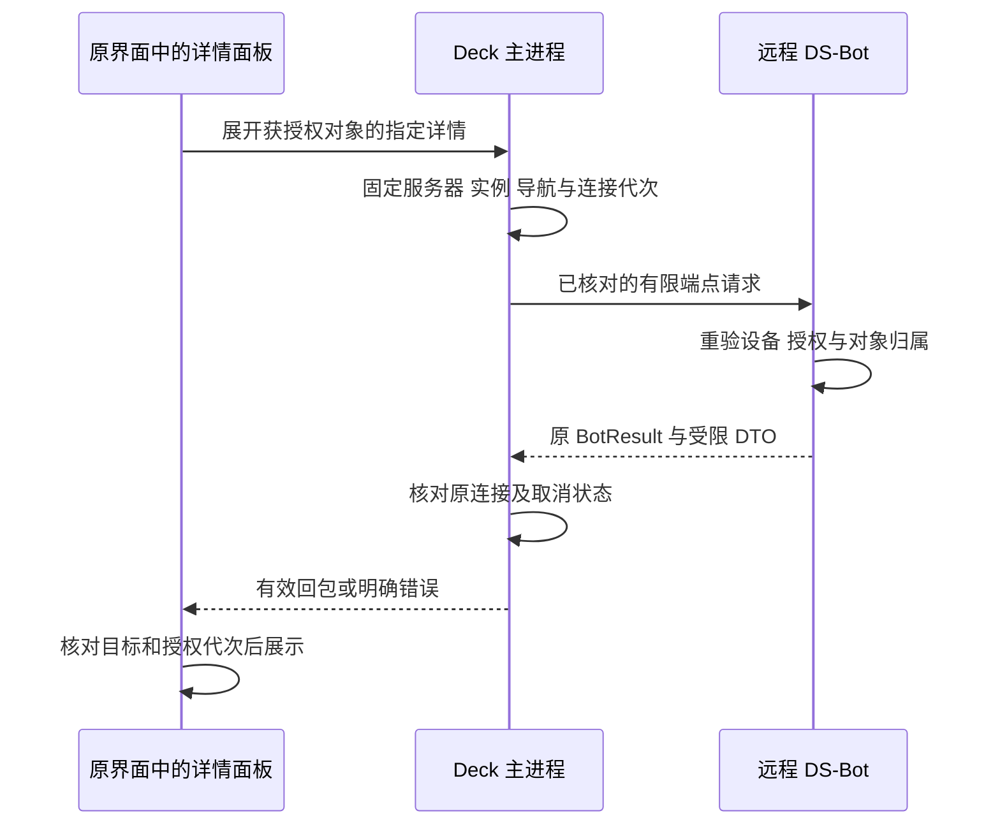
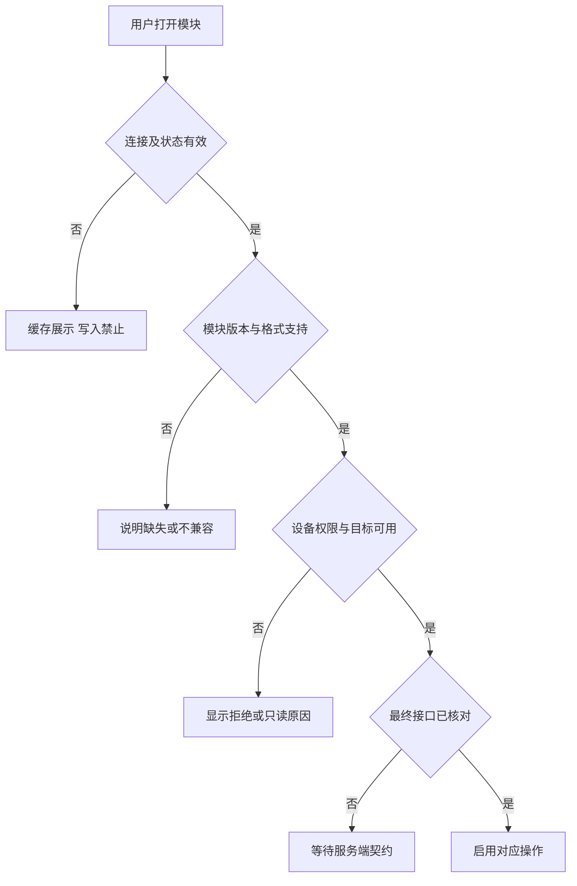
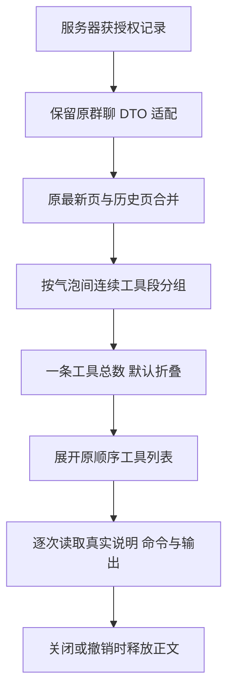
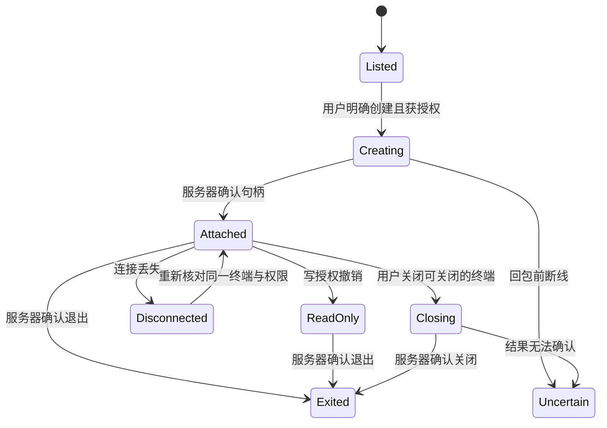
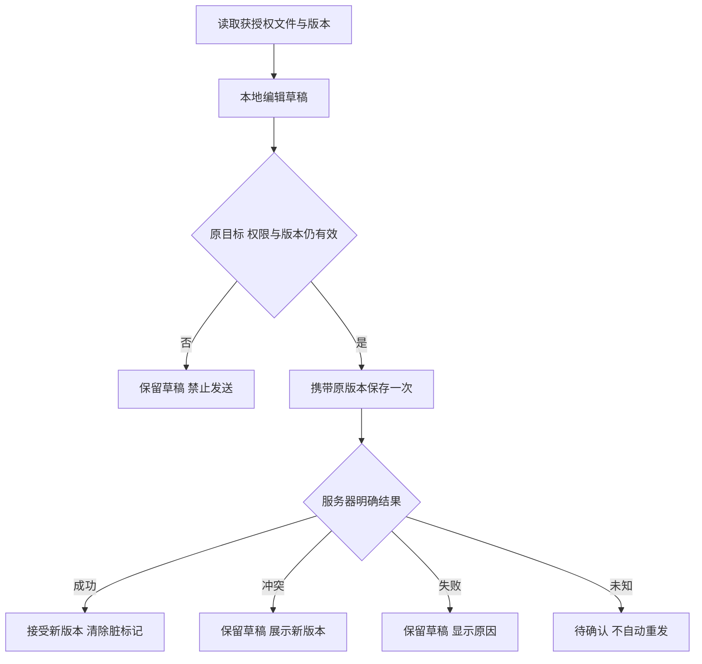

# DSBotDeck 对齐 DSH Web 交互与紧凑工具记录

## Goal Capsule

- 目标：恢复会话详情、Bot 互聊、委派过程、服务器终端、工作区文件浏览与编辑，并让气泡间的工具记录紧凑、可理解。
- 权威：本轮用户确认的范围与现行 `AGENTS.md` 优先；旧计划仅提供架构参考，不恢复其已取消的强制 Windows Hello。
- 工作位置：仅 `DSBotDeck`；`../DS-Bot/` 与 `../DshDeck/` 只读，服务端补充由另一个会话负责。
- 执行起点：U1 可先实施；U2 先复核已有入口补丁；U3 接现有增补读取；其他单元按依赖和模块门禁推进。文档可启动分阶段实施，不表示外部服务端能力已交付。
- 停止条件：服务端契约、设备授权或公开组件缺失时，停止受影响模块并回报缺口；独立单元可以继续，门禁未过的单元不能计为完成。
- 验证边界：代理只定义回归并做静态审查；类型、测试、构建、安装、服务与实机验证由用户或 CI 执行。
- 交付边界：不自动提交、推送、发布，不改变配对身份，不代管服务器数据。全量完成必须有服务端联调与真实运行证据。

---

## Product Contract

### Summary

本计划覆盖用户选择的完整 DSH Web 交互范围，而非仅画出面板或补按钮。
沿用原组件和受限加密链路，已有接口先接通，新增服务端能力通过契约与授权门禁上线。
气泡间连续工具只占一条“用了 N 个工具”，展开后采用原版 Agents 的工具说明、命令与输出呈现方式。

### Problem Frame

前一版把顶部头像重定向到参数页，原会话详情入口失去原语义；最新工作区已有恢复补丁，仍需验收。
连续的单次工具摘要即使全部折叠，仍各占一行，导致聊天页面过长。
只有英文工具名或通用说明时，用户不容易理解调用目的。
部分远程 DTO 缺少协作来源与完整运行元信息，单靠客户端无法恢复互聊跳转、真实委派、交互终端或文件修改详情。
重试成功后的残留红灯还缺完整生命周期证据，不能用任意回复或网络恢复冒充正常完成。

### Actors

- A1. 用户：在 Deck 查看远程工作，展开工具，操作获授权的服务器终端与工作区文件。
- A2. Deck：只呈现远程事实，隔离每台服务器及界面实例，不启动本机 DSH、Agent 或终端。
- A3. 服务端及其维护会话：解析真实归属、执行最终授权、提供版本化接口与运行证据。

### Requirements

**入口与工具展示**

- R1. 顶部头像胶囊恢复原会话详情，Bot／群参数仍通过独立入口打开。
- R2. 同一聊天目标中相邻的工具记录合并为一个默认折叠的“用了 N 个工具”；消息气泡、非工具事件和会话边界终止分组。
- R3. 合并只改变展示，不删除或重排调用；同名调用分别计数，各调用仍保留自己的轮次与关联标识。
- R4. 展开后的工具列表按原版 Agents 的层次呈现：工具类别、真实任务说明、命令／参数、输出与可用的复制入口。
- R5. 可理解的标题来自服务器实际记录的说明或已读取参数中的 `description`／`justification`，缺失时显示工具原名或已知通用说明，不编造目的。
- R6. 工具成功、失败和未确认来自明确结果；命令与输出保持只读，展开工具不执行命令或自动批准工具请求。

**协作、任务与资源**

- R7. Bot 互聊用经授权、经目录解析的稳定编号打开原交换记录；群聊结束、失败、定时事件不能误渲染为“Message from a Bot”。
- R8. DSH 子 Agent 委派与 DS-Bot 后台任务分开，显示真实父子归属、状态、过程和结果。
- R9. 服务器终端支持输出读取及获授权的创建、输入、调整和关闭；能力探测或打开面板不自动创建终端。
- R10. 工作区支持受限文件树与预览，根目录由服务器按 Bot／群／会话解析，客户端只使用根句柄和相对路径。
- R11. 文件编辑使用服务器写授权和原版本前置条件；冲突不得覆盖，结果不确定不得假装保存成功。
- R12. 工具修改详情只来自已应用的真实结果元信息，例如已记录的 `data.meta.diffs`；工具输入不是已应用修改，缺旧文字不能伪造完整 diff。
- R13. 当前红灯与历史失败分开；同一故障的真实重试成功应恢复当前状态，无关或迟到成功不能误清新故障。

**权限、隔离与兼容**

- R14. 能力声明包含模块版本、支持范围和当前授权；缺失、拒绝、锁定、暂不可用和格式不兼容分别显示，不用空列表冒充支持。
- R15. 完整消息、资源读取与资源写入分别授权，服务端按设备身份、配对时间和实际对象归属作最终判定。
- R16. 所有请求与结果绑定服务器、连接代次、界面实例、导航目标及授权代次；切服、换段、撤销或重配后的旧回包不得污染新上下文。
- R17. 断线与缓存禁止写入，不自动重发终端输入或文件保存；已发出的操作被取消时，如无法证明未执行，应显示结果待确认。
- R18. 保留真实密钥保护，正常业务内容不因容器字段被整体遮盖；不能还原源头已打码的数据，也不能把脱敏预览写回秘密文件。
- R19. 折叠不加载参数和输出，隐藏面板不持续轮询；分页、缓存、内容大小与监听均有预算，合并和刷新不能跳动用户正在阅读的位置。
- R20. 保留现有窗口校准、半屏／自定义 DIP、设置分类、`@`／`/`、主题、背景、宠物与审批行为；不增加本机 Host、电脑／浏览器接管、通用 RPC 代理或未经确认的新依赖。
- R21. 回归覆盖事实状态与失败边界，不删断言、跳过用例或延长超时掩盖错误；运行验证交由用户／CI。

### Key Decisions

- KD1. 全范围纳入分阶段计划，而非只补当前客户端入口。Governs R1–R21。（session-settled: user-directed — chosen over implementing only existing client features: 用户选择先完成完整实施计划，并确认服务端就绪门禁。）
- KD2. 按气泡间连续工具段合并，不跨气泡汇总整个轮次。Governs R2、R3、R19。（session-settled: user-directed — chosen over one summary for the entire turn: 用户希望减少滚动，同时保留工具与中间回复的对应位置。）
- KD3. 折叠只留总数，展开采用原版 Agents 的可理解说明与命令／输出层次。Governs R4、R5、R6。（session-settled: user-directed — chosen over a list of raw tool names: 用户通过第二张截图要求说明调用目的，而非只列英文名称。）
- KD4. 保留密钥保护，不全面取消远程读取脱敏。Governs R18。（session-settled: user-directed — chosen over unredacted remote extras: 用户在脱敏范围选择中明确保留密钥保护。）

### Key Flows

- F1. 工具查看：用户阅读气泡间总数，展开工具段，再展开某次调用；只读取该调用获授权的详情，关闭后释放敏感正文。
- F2. 会话与互聊：头像打开原详情，参数入口独立；协作消息用稳定来源打开交换记录，不能验证来源时解释不可打开。
- F3. 服务器资源：确认能力与当前权限后进入委派／终端／文件面板；任何操作始终留在原服务器与原所属对象。
- F4. 重试与恢复：读取当前运行事实和最新团队状态；正常完成、重试耗尽、取消、缓存及无关成功分别处理。

### Acceptance Examples

- AE1. 一段连续记录原来显示 11 条“用了 1 个工具”，现在只显示“用了 11 个工具”；下一条消息后重新分组。展开仍能找到全部 11 次调用。Covers R2、R3。
- AE2. 服务器记录含“查找 ProposalSchema 定义位置”时，展开显示该说明及实际命令和输出；缺说明时不生成同样的标题。Covers R4、R5、R6。
- AE3. 顶部头像打开原详情，详情的参数按钮仍到正确 Bot／群设置；切服务器不把旧详情带到新服务器。Covers R1、R16。
- AE4. 未授权交换记录显示拒绝原因；授权后打开真实 Bot 对；群 done／failed／schedule 事件不进入互聊。Covers R7、R14、R15。
- AE5. 父任务结束而子 Agent 仍运行时，委派继续显示运行；后台任务失败不能冒充子 Agent 失败或另一 Bot 的故障。Covers R8、R13。
- AE6. 终端输入发出后断线，重连不重发；关闭聊天面板不关闭 Agent 正在使用的终端。Covers R9、R16、R17。
- AE7. 文件打开后被 Agent 修改，用户按旧版本保存时得到冲突；本地草稿保留，但服务器新文件不被覆盖。Covers R10、R11。
- AE8. 工具结果没有有效 diff 时，只显示实际命令／输出和明确缺口，不把参数当作已应用的修改。Covers R12。
- AE9. 同一故障重试正常完成后当前红灯消失；重试耗尽仍红；旧会话成功不清除新故障。Covers R13。
- AE10. 旧服务器只提供摘要时仍可聊天与折叠工具；增补接口授权拒绝或网络错误不会悄悄降级读取。Covers R14、R18。

### Scope Boundaries

- 本轮实现目标属于 Deck；服务端契约与补充实现是外部前置条件，不授权本会话写相邻仓库。
- 原参数、审批与服务器权限保留，不恢复标准 Deck 额外强制的 Windows Hello，不自动或永久批准工具。
- 不提供桌面／浏览器画面、键鼠或接管，不引入 SSH、任意根目录访问或客户端命令执行网关。
- 文件编辑属于服务器已授权工作区，不默认开放凭据、配对身份库或任意 `DSH_HOME`。
- 不把工具失败、终端退出或文件保存等同于整个 Bot 工作完成。

### Deferred to Follow-Up Work

- 服务端新增接口、来源字段、真实委派读取、终端／文件授权及阻塞生命周期修复，由服务端维护会话实施并回传。
- 本轮既有 DS-Bot 脱敏修复分支的验证和发布独立处理，不作为已部署功能或 Deck 构建源码来源。
- 新依赖或固定上游来源调整若确实必要，先说明原因并征求用户意见，不夹带在 UI 还原中。

---

## Planning Contract

### Verified Baseline

- Deck 当前为 `fix/window-roundtrip-composer`，HEAD `6b15773458b3241ebb1bb59a4faff4cbed9c4f49`，源码版本 `0.1.6`；已有窗口、设置分类和 Composer 改动未提交。
- `scripts/upstream.mjs` 的 `REFERENCE_COMMIT` 为 `d104d9ca18d69a35460f14e15dff4d553181433a`；构建来源和实际服务端增补版本是不同概念。
- 当前服务端参考提交为 `b1745e8a7016745130e09ac53bded84e1689fd3f`，增补包 `0.3.10-addons.1`；测试 Harness 固定 `@deepseek-ai/dsh@0.2.2-rc.1`，实际部署版本仍需回传。
- 最后只读复核发现新的未提交工作：`src/remote/app.js` 已撤掉头像到参数页的覆盖；U2 先验收现有接线，不重复实现。
- Deck `ToolSteps` 仍为每条 `steps` 单独建立折叠块；`toolSummaries` 仅提取名称、通用说明和布尔结果。
- 原版 `../DS-Bot/app/ui/src/chat.js` 已含 `adaptRoomItem` 与 `mergeLatestPage`，必须保留；固定原版读取仍是 `chat`／`room-chat`。
- 当前 `src/main/protocol.ts` 只对原 `chat`／`room-chat`／`bot-task-read` 建立已读回执；增补读取接入后不能遗漏蓝灯记账。
- `src/shared/endpoint-policy.ts` 引用固定原版的浏览器端点集合；默认手机门禁并不装配 Windows Hello。不能靠改配对类别或泛化未知端点放行新能力。
- `src/shared/chat-model.ts`、`src/remote/peer-event.js` 与构建适配已新增稳定 Bot 对、交换错误和缺来源提示；U4 继续复用这些已有补丁，不重造同类模型。
- 服务端现有 `extra-status`、`extra-messages`、`extra-task-read`、`extra-tool-list`、`extra-tool-detail`、`extra-todos` 与原交换接口可复用。
- 完整消息 `internal` 行目前缺稳定发送者编号；工具详情只允许 `arguments`／`output`，没有返回结果修改元信息。
- `../DS-Bot/ds-bot/src/host/parts.js` 的 `toolLabel` 是通用动作说明；`../DS-Bot/ds-bot/src/host/turns.js` 的 `callDetail` 从实际参数读取 `description`／`justification` 与命令／路径等，但这是当前审批详情，不是已完成的历史工具说明协议。
- 服务端完成分支已有 `forgetFailure`／`unblockBot`；成功后残留的完整因果链尚未查明。最新 Deck 补丁让 busy 优先，并在重连／阻塞对象新消息等情况下复读完整 state；这不是已证明的同故障关联修复，U9 必须复核。
- 上述新增代码和回归并非本轮计划编写产生，未在本轮运行验证；实施前再次读取工作区，保留所有已有和并行改动。

### Key Technical Decisions

- KTD1. **保留固定原版 UI，新增薄适配。** 原详情、交换、聊天行、代码展示、样式与主题优先复用公开组件。增补源码中才有的组件不能假装存在于 `d104`，也不能把当前增补工作树直接当作固定构建来源。Covers R1、R4、R20。
- KTD2. **工具分组是展示模型。** 在原分页合并和授权投影之后分组，原始调用及其轮次不变；按已有标识消除同一记录的重复读取，不按名称去重。Covers R2、R3、R19；KD2。
- KTD3. **分阶段契约门禁。** 现有端点按已核对协议接入；未来模块只有版本、DTO、错误与授权语义冻结后才绑定有限端点。能力响应不能提供可直接执行的任意 RPC 字符串。Covers R14、R15、R20。
- KTD4. **说明与正文分层读取。** 服务端若有获授权的短说明，在工具段展开后显示；没有时可用已读取参数中的真实说明。不得为补标题在折叠状态批量下载全部参数。Covers R4、R5、R18、R19；KD3。
- KTD5. **双重隔离。** 主进程保持连接／导航／实例边界，面板保持目标／授权代次边界；完整消息授权撤销时清空敏感正文及派生标题，旧读回包不再展示。Covers R15、R16、R17、R18。
- KTD6. **原交换协议优先。** 普通群聊 DTO 沿用原适配，增补内部消息单独适配；来源缺失时保留正文和不可打开说明，不猜 Bot 名或把 Session 编号当 Bot 编号。Covers R7、R14。
- KTD7. **终端与文件操作只在服务器执行。** 用户创建的终端和 Agent 使用的终端区分所有权；文件使用服务器根句柄与版本前置条件。客户端只负责呈现、输入、校验和冲突处理。Covers R9、R10、R11、R15、R17。
- KTD8. **修改详情与编辑分开。** 工具 diff 是某次已记录修改的只读证据；编辑器读的是当前获授权文件，两者不互相冒充快照。Covers R11、R12、R18。
- KTD9. **最新可信状态是事实源。** 当前运行、历史失败和未查看结果分开投影；服务端仍有真实阻塞时不在客户端改掉 `blocked`。需要定位服务端未撤销还是删除状态未到达。Covers R13、R16。
- KTD10. **有界读取。** 优先沿用上游单飞、分页及可见性控制；新增模块设置更小的局部预算，不提高现有全局请求上限。回包格式错误不能降级成空成功。Covers R14、R19。

### High-Level Technical Design

组件与权限边界：

详情读取与旧回包拒绝：

模块启用门禁：

工具展示数据流：

服务器终端生命周期：

文件保存与冲突：

### Server Contract Gates

以下是所需语义，不是已发布 DTO，也不是客户端可直接硬编码的草案端点。
服务端会话应为每个模块回传版本、最终接口、请求／响应／事件样例、游标、错误、归属与授权撤销规则。

| 门禁 | 所需回传 | 影响单元 | 未满足时 |
| --- | --- | --- | --- |
| C1. 现有增补读取 | 实际部署版本、设备完整消息授权、当前能力响应；原 `extra-*` 已存在接口的样例 | U3、U4 | 只保留原版读取与明确缺口；拒绝不可吞掉 |
| C2. 工具说明与协作来源 | 脱敏短说明、稳定发送者／接收者及可用交换关联；来源不可见规则 | U3、U4 | 显示原名或通用说明；不伪造跳转 |
| C3. 委派 | 真实父子归属、生命周期、明确结果、可读范围和分页 | U5 | 不展示空面板冒充委派支持 |
| C4. 终端 | 公开 PTY 服务、句柄所有权、读写授权、输出游标、退出与不确定结果语义 | U6 | 终端输入／创建保持不可用 |
| C5. 工作区 | 根句柄、相对路径、规范化安全、读写权限、编码／预算、文件版本与原子保存 | U7、U8 | 可用的旧附件仍可读；不冒充工作区读写 |
| C6. 修改元信息 | 工具已应用结果中的有效文件 diff、预算、不可见和不完整说明 | U7 | 仅展示真实命令与输出，不造修改详情 |
| C7. 重试状态 | 同一故障／尝试／会话关联、完成与耗尽事实、阻塞撤销与状态发布证据 | U9 | 不擅自清服务器阻塞或宣称根因修复 |

任何模块的写入还需服务端明确的设备授权政策；完整消息授权不是通用写权限。
客户端只实现经回传核对的接口，不注册文档中的建议接口族。

### Budgets and Error Semantics

- 工具沿用现有 `offset`／`digest` 与 32 Ki 字符分段，正文总上限不得高于服务端现有 2 Mi 字符限制；拼接不插入任意换行，digest 变化重新读取首段。
- 新终端读取建议单批不超过 64 KiB、单面板缓存不超过 1 MiB；新建终端数量由服务器给出且客户端有限制。最终取服务器约束与客户端预算的较小值。
- 工作区文本预览／编辑建议上限 1 MiB，目录单页建议不超过 200 项；截断、非完整解码和脱敏预览不得成为可保存的完整文件。
- 输出使用纯文本或原安全代码组件，服务器正文不能作为 HTML、脚本或本机命令执行；复制只复制已展示的获授权内容。
- 只有 `bot/not-found` 且消息明确指向当前缺失的增补端点时，既有读取可回退；授权拒绝、锁定、网络、其他不存在错误及格式错误不回退。
- 新模块错误码由最终契约确认。客户端至少区分缺失／不兼容、拒绝／撤销、繁忙、冲突／版本过期、预算／编码、网络／结果未知。

### Phased Delivery

1. 先完成不依赖新增服务端的 U1、U2，直接缓解滚动与详情入口问题。
2. 接通 C1 支持的 U3，并保留原读取与已读回执；C2 不足时如实保留通用标题和不可跳转状态。
3. 按 C2–C7 分别解锁 U4–U9。门禁未过不妨碍独立模块，但不能标记相应功能完成。
4. U10 汇总回归与实机证据，才评估整体交付；本计划不指定版本号、不改旧 Release、不自动打包或发布。

### System-Wide Impact

- 增补读取会改变聊天回执和蓝灯路径，必须同步更新协议识别，不能把工具展开、错误页或缓存页算作已读结果。
- 原 UI 状态、Shell 状态与宠物状态来自不同投影，U9 必须用同一最新事实对齐，而不是各自清红灯。
- Agent 与用户共享服务器工作区，文件版本和冲突保护是必需边界；Deck 不新增 Agent 工具或绕过单次审批。
- 终端面板的监听与输入生命周期不同于聊天，隐藏、断线、关闭页面不等于远程进程终止。
- 既有窗口和 Composer 未提交工作与本计划相交于构建适配文件；实施前读取最新内容，禁止整文件覆盖或代为提交。

### Open Questions

以下均是执行阶段或外部交付门禁，不影响 U1、U2 的启动；未解决会阻塞对应模块和整体 DoD。

- Q1. 实际服务器 DSH／DS-Bot／插件版本及当前设备授权是什么？由服务端会话回传，启用 U3–U9 前核对，不以 Harness 版本冒充部署版本。
- Q2. C2–C7 的最终接口和 DTO 是什么？由服务端冻结，属于对应联调单元的外部阻断项，不由 Deck 从草案猜测。
- Q3. 原版 Agents 的完整工具／终端组件是否有可复用的公开导出？实施时只读审计；没有则保持薄适配，任何新增依赖或来源变更先征求意见。
- Q4. 重试成功后的阻塞在哪个环节残留？先收集白名单生命周期和最新 state 证据，不能从当前优先级直接推断完整根因。

---

## Implementation Units

路径均相对 Deck；标注“新增”的文件是实施目标，本轮规划不创建源码或测试。

| 单元 | 目标 | 主要文件 | 依赖 |
| --- | --- | --- | --- |
| U1 | 气泡间工具合并 | `src/shared/tool-history.ts`、`src/remote/tool-steps.js` | 无 |
| U2 | 原会话详情入口 | `src/remote/app.js` | 无 |
| U3 | 增补读取与 Agents 工具详情 | `src/shared/remote-capabilities.ts`、`src/remote/tool-detail.js`、`src/main/protocol.ts` | U1；C1，增强标题需 C2 |
| U4 | 稳定来源与原交换记录 | `src/shared/chat-model.ts`、`src/remote/peer-event.js`、`scripts/paint-source.mjs` | U3；C2 |
| U5 | 真实委派过程 | `src/shared/delegation-model.ts`、`src/remote/delegations.js` | U3；C3 |
| U6 | 服务器交互终端 | `src/shared/terminal-model.ts`、`src/remote/terminal-pane.js` | U3；C4 |
| U7 | 文件树、预览与修改详情 | `src/shared/workspace-model.ts`、`src/remote/workspace-pane.js` | U3；C5，修改详情需 C6 |
| U8 | 文件编辑与冲突 | `src/remote/workspace-editor.js` | U7；C5 写契约 |
| U9 | 当前重试与红灯一致性 | `src/shared/task-model.ts`、`src/main/server-connection.ts` | 可先做既有状态特征覆盖；完整修复需 C7 |
| U10 | 回归、联调与交付文档 | `docs/verification/remote-client.md`、`docs/integration/server-parity-contract.md` | U1–U9 |

### U1. 气泡间连续工具合并

- **Goal:** 每段连续工具默认只占一条总数，减少滚动。
- **Requirements:** R2、R3、R19、R20；KD2；F1、AE1。
- **Dependencies:** 无新增服务端依赖。
- **Files:** `src/shared/tool-history.ts`（新增）、`src/shared/tool-model.ts`、`src/remote/tool-steps.js`、`src/remote/tool-steps.css`、`scripts/paint-source.mjs`、`tests/tool-history.test.ts`（新增）、`tests/tool-model.test.ts`、`tests/upstream.test.ts`。
- **Approach:**
  1. 为原聊天与后台任务增加同一个纯分组模型，保留原始子记录。
  2. 让一个分组使用现有折叠组件，默认只显示总数，内部保留调用顺序和状态。
  3. 继续使用原最新页合并与滚动锚点，不把分组后的行写回原聊天状态。
- **Execution note:** 先为截图中的重复单次摘要建立特征覆盖，再改变展示。
- **Patterns to follow:** `toolSummaries`、只读 `paintSource` 唯一锚点、原 `mergeLatestPage`。
- **Test scenarios:**
  - Covers AE1. 11 条相邻单次记录变为一个总数，展开保留 11 次。
  - 中间出现用户／Bot 气泡或诊断／分段事件时产生两个分组。
  - 同名工具多次调用仍分别计数；具有同一调用标识的重复读取不重复增加。
  - 缺标识的旧服务器记录保留实际出现次数，不按名称或内容猜去重。
  - 不同服务器、会话或聊天目标不能合并；每个子调用仍使用自己的轮次／callId。
  - 最新页刷新和追加旧页后，计数、展开状态及视口锚点不跳变；不修改输入记录。
  - 折叠不发详情请求，空工具段不生成无意义摘要。
- **Verification:** 主聊天、群聊与后台任务使用同一分组语义；用户按第一张截图实机确认行高减少。

### U2. 恢复原会话详情入口

- **Goal:** 顶部头像与参数设置各自回到原语义。
- **Requirements:** R1、R16、R20；F2、AE3；KTD1。
- **Dependencies:** 无新增服务端依赖。
- **Files:** `src/remote/app.js`、`src/shared/navigation.ts`、`scripts/paint-source.mjs`、`tests/navigation.test.ts`、`tests/deck-ui.test.ts`、`tests/upstream.test.ts`。
- **Approach:** 先复核工作区已撤掉的头像重定向及原 `HeaderPill`／`DetailsDrawer` 接线，只补缺口；保留独立参数入口及被隐藏的电脑／浏览器控制边界。
- **Patterns to follow:** 原 `toggleDetails`、`openSettings` 与现有目标导航。
- **Test scenarios:**
  - Covers AE3. Bot／群头像打开原详情，参数按钮打开正确设置。
  - 自动换段、目标删除与切服务器后，旧详情不指向新对象。
  - 缓存禁止会改变远端的动作，已有只读信息仍可解释地展示。
  - 原任务、记忆和用量入口保留，电脑／浏览器接管不重新出现。
  - 本机齿轮、现有五类设置与 Composer 草稿不受入口恢复影响。
- **Verification:** 原组件接线和导航静态核对；用户验证详情与参数是两个不同入口。

### U3. 增补读取与 Agents 风格工具详情

- **Goal:** 接现有真实参数／输出，并按截图显示可理解的工具说明和代码正文。
- **Requirements:** R4、R5、R6、R14–R19；KD3、KD4；F1、AE2、AE10；KTD3、KTD4、KTD5。
- **Dependencies:** U1；C1，增强短说明需 C2。缺少 C2 不阻止真实参数／输出读取，但不得宣称所有标题已还原。
- **Files:** `src/shared/remote-capabilities.ts`（新增）、`src/shared/extra-read-model.ts`（新增）、`src/remote/tool-detail.js`（新增）、`src/remote/tool-steps.js`、`src/remote/tool-steps.css`、`src/shared/tool-model.ts`、`src/shared/endpoint-policy.ts`、`src/main/protocol.ts`、`scripts/paint-source.mjs`、`scripts/upstream.mjs`、`tests/extra-read-model.test.ts`（新增）、`tests/tool-detail.test.ts`（新增）、`tests/request-gate.test.ts`、`tests/protocol.test.ts`、`tests/upstream.test.ts`。
- **Approach:**
  1. 为已核对端点建立能力／权限模型和明确的原版回退，不扩大未知 RPC。
  2. 接增补聊天与后台读取，保留原群 DTO 适配和分页，补充对应已读回执识别。
  3. 展开工具段显示真实说明，逐次展开调用后显示命令／参数和输出，复用可用的原安全代码组件及样式。
  4. 保留 offset／digest、错误、锁定和授权撤销语义；关闭清空正文，复制不变成执行。
- **Patterns to follow:** 原读取与 `mergeLatestPage`；现有 `RequestGate`／`ReadReceipt`；服务端 `extra-tool-detail`；原 `callDetail` 的真实说明提取来源。
- **Test scenarios:**
  - Covers AE2. 有真实说明显示任务标题与原命令／输出，无说明只显示可证实名称。
  - 折叠不读取正文；展开标题不触发全历史参数批量下载。
  - 工具列表标识保留，单个详情请求固定原调用和会话，旧回包不进入新面板。
  - 详情分段按 offset 直接拼接，digest 改变、越界及半个代理字符边界如实处理。
  - Covers AE10. 仅明确缺失当前增补端点才回退；拒绝、网络、锁定与其他错误保留。
  - 增补最新聊天／任务页完成布局后才确认蓝灯；工具展开、历史页、失败页和缓存页不误确认。
  - 浏览器配对只能使用服务器允许的对应读取；不能借 `fullMessages=true` 或名称提权。
  - 授权撤销清空已显示正文和说明，下一页及迟到回包被丢弃；普通正文仍作为安全文本。
- **Verification:** 参数／输出和说明均有真实来源；用户按第二张截图确认展开层次、复制与状态，不将薄适配声称为已接入不存在的原组件。

### U4. 协作来源与原交换记录

- **Goal:** 正确区分群事件与互聊，按真实来源打开原交换记录。
- **Requirements:** R7、R14–R18；F2、AE4；KTD6。
- **Dependencies:** U3；增强内部消息跳转需 C2。
- **Files:** `src/shared/chat-model.ts`、`src/remote/peer-event.js`、`scripts/paint-source.mjs`、`scripts/upstream.mjs`、`tests/chat-model.test.ts`、`tests/upstream.test.ts`、`tests/remote-integration.test.ts`。
- **Approach:**
  1. 先复核已有稳定 Bot 对、交换错误和缺来源提示；保留普通群聊 `adaptRoomItem`，只扩展 `internal`／诊断等新行。
  2. 在现有模型和原 `openExchange`／`ExchangeDialog` 上接确认后的来源字段，补撤销与长正文边界，不复制交换功能。
  3. 缺失或不可见来源时不猜目标，原交换与长正文接口不重造。
- **Patterns to follow:** 现有 `botExchangePair`／`exchangeFailure`／`PeerEvent`，原 `ChatRows`／`ExchangeDialog`，稳定目录别名与本项目目标隔离。
- **Test scenarios:**
  - Covers AE4. 授权后的真实 Bot 对打开交换记录，未授权显示拒绝而不是空会话。
  - 同名 Bot、历史 Session 别名与删除对象不导致猜测跳转。
  - done／failed／schedule／report 及资料更新事件保持真实类型。
  - 无稳定来源、私密来源或不可见目标不泄露编号，不伪造可点击头像。
  - 长正文读取失败可重试，错误不被空列表替代；关闭、撤销或切服后轮询和旧回包停止。
  - 原与增补群聊分页、步骤、文件附件与流式回复不重复、不丢失。
- **Verification:** 消息显示、点击目标、交换权限和长正文使用同一真实关联；服务端字段缺失明确列为未完成项。

### U5. 真实 DSH 委派过程

- **Goal:** 委派的父子关系与过程可展开，不混同后台任务。
- **Requirements:** R8、R13–R19；F3、AE5。
- **Dependencies:** U3；C3。
- **Files:** `src/shared/delegation-model.ts`（新增）、`src/remote/delegations.js`（新增）、`src/remote/app.js`、`src/shared/endpoint-policy.ts`、`tests/delegation-model.test.ts`（新增）、`tests/remote-integration.test.ts`。
- **Approach:** 使用经冻结的受限委派目录与分页；原后台任务仍用原组件，新面板按服务器事实呈现父子状态，不开放任意 Agent／Session 页。
- **Patterns to follow:** 原 TaskRead 的分页、错误和关闭清理；本项目状态与网络分离模型。
- **Test scenarios:**
  - Covers AE5. 父任务结束、子任务仍运行时不误判完成。
  - 同名委派、跨 Bot、跨群和历史父任务不会串归属。
  - 完成、明确失败、取消和状态未知分别呈现；后台失败不套到子 Agent。
  - 无能力、无权限、归属不符与损坏 DTO 显示明确原因。
  - 过程分页保持父子边界，隐藏面板停止读取，撤销／切服丢弃旧正文。
- **Verification:** 所有状态和结果来自受限服务端记录；仅凭截图或 mock 不认定真实委派联调完成。

### U6. 服务器交互终端

- **Goal:** 用户可查看和操作获授权的服务器 PTY，不创建本机执行器。
- **Requirements:** R9、R14–R20；F3、AE6；KTD7、KTD10。
- **Dependencies:** U3；C4，公开终端呈现组件的可用性需完成审计。
- **Files:** `src/shared/terminal-model.ts`（新增）、`src/remote/terminal-pane.js`（新增）、`src/remote/app.js`、`src/shared/endpoint-policy.ts`、`src/main/request-gate.ts`、`tests/terminal-model.test.ts`（新增）、`tests/request-gate.test.ts`、`tests/remote-integration.test.ts`。
- **Approach:**
  1. 能力探测只读取目录；用户明确操作才创建服务器终端。
  2. 句柄绑定服务器、设备与会话，读写权限与终端所有权分开。
  3. 输出按游标、预算和可见性读取；输入只发一次，尺寸调整仅作用于当前有效句柄。
  4. 退出／关闭确认与未知结果分别处理，页面清理不关闭 Agent 终端。
- **Patterns to follow:** 原连接代次与取消语义、受限 scheme、面板监听清理。
- **Test scenarios:**
  - Covers AE6. 探测／打开面板不创建终端，关闭面板不关闭 Agent 的终端。
  - 只读设备不能输入或创建；撤销写授权即时禁用输入。
  - 输入发出后断线或 A→B→A 切服不重发、不投递到新目标。
  - 调整／关闭过期句柄被拒绝，Agent 所属终端不能被普通关闭动作接管。
  - 输出游标重复、截断、退出码及缓存耗尽均明确处理。
  - 关闭／取消的结果无法证实时显示待确认，不假装远程未执行。
  - 渲染源码不含本机 `child_process` 或任意命令执行入口；控制转义序列和链接不取得本机特权。
- **Verification:** 使用真实服务器 PTY 联调，确认交互、只读降级、退出和断线输入；普通工具输出展示不替代该验收。

### U7. 文件树、预览与修改详情

- **Goal:** 浏览获授权工作区，并区分当前文件与历史工具 diff。
- **Requirements:** R10、R12、R14–R20；F3、AE8；KTD7、KTD8。
- **Dependencies:** U3；文件浏览需 C5，历史修改详情需 C6。
- **Files:** `src/shared/workspace-model.ts`（新增）、`src/shared/change-model.ts`（新增）、`src/remote/workspace-pane.js`（新增）、`src/remote/change-detail.js`（新增）、`src/remote/app.js`、`src/shared/endpoint-policy.ts`、`tests/workspace-model.test.ts`（新增）、`tests/change-model.test.ts`（新增）、`tests/remote-integration.test.ts`。
- **Approach:** 根句柄由服务器提供；目录分页和文本预览受预算控制。修改详情使用真实结果元信息，点击文件只通过同一获授权工作区重新读取当前版本。
- **Patterns to follow:** 原附件／代码／文件展示组件；原受限读取与错误模型。
- **Test scenarios:**
  - 根来自当前 Bot／群，目录和预览不能切到任意绝对路径或另一对象。
  - 拒绝 `..`、绝对路径、UNC／ADS／URL 与链接越界；服务端还须验证真实规范化目标。
  - 二进制、非完整解码、过大文件、空目录和分页末尾分别说明。
  - Covers AE8. 有真实 oldText／newText 才展示相应修改，无有效结果不能从参数生成已应用 diff。
  - 缺旧文字显示不完整，不伪造新建文件；不同文件和工具调用的修改不混合。
  - 原附件仍可读，文件分享插件的只读接口不被冒充为写接口。
  - 缓存、撤销或切服清理敏感预览，旧根句柄和回包不能复用。
- **Verification:** 当前预览与历史修改有明确来源标签；目录安全和 diff 真伪需要真实服务端验收。

### U8. 文件编辑与冲突保护

- **Goal:** 获授权文件可以安全编辑，冲突不覆盖服务器新内容。
- **Requirements:** R11、R15–R19；F3、AE7；KTD7、KTD8。
- **Dependencies:** U7；C5 的写入前置条件、原子保存和敏感文件政策已冻结。
- **Files:** `src/remote/workspace-editor.js`（新增）、`src/shared/workspace-model.ts`、`src/shared/endpoint-policy.ts`、`src/main/request-gate.ts`、`tests/workspace-editor.test.ts`（新增）、`tests/request-gate.test.ts`、`tests/remote-integration.test.ts`。
- **Approach:** 草稿绑定原文件与版本，保存只发送一次。冲突保留草稿并读取新版本供比较；成功只以服务器返回的新版本为准，不增加强制覆盖入口。
- **Patterns to follow:** 原冻结 payload、目标代次和错误反馈；原保存失败保留草稿行为。
- **Test scenarios:**
  - Covers AE7. Agent 改文件后旧版本保存被拒绝，草稿与服务器新内容均保留。
  - 文件被移动／删除、写权限撤销、目标换段与缓存状态不发送旧保存。
  - 连续点击不重复提交，发送后断线／取消显示结果待确认，不自动重发。
  - 非完整、截断、二进制或脱敏预览不能开启可保存编辑器。
  - 敏感文件按服务器政策拒绝，不能把遮盖值覆盖原秘密。
  - 明确保存失败、冲突和成功后新版本分别处理；不把用户草稿当服务端事实。
- **Verification:** 真实版本竞争、原子保存和权限撤销成立；只有 UI 草稿保留的测试不能证明服务器保存安全。

### U9. 当前重试与红灯一致性

- **Goal:** 对齐侧栏、宠物和原会话状态，保留真实故障并清除已解决的当前故障。
- **Requirements:** R13、R14、R16、R17、R20；F4、AE9；KTD9。
- **Dependencies:** 既有 `state` 的特征覆盖可独立开始；完整重试关联和根因修复需 C7。
- **Files:** `src/shared/task-model.ts`、`src/main/server-connection.ts`、`src/shared/domain.ts`、`src/renderer/app.js`、`src/renderer/pet.js`、`tests/task-model.test.ts`、`tests/server-connection.test.ts`、`tests/remote-integration.test.ts`。
- **Approach:**
  1. 先复核已有 busy 优先和完整 state 重读补丁，定位增量合并、旧回包与 UI 投影是否正确传递阻塞撤销。
  2. 根据同一故障的可信运行关联处理“正在恢复”和最终结果，历史错误独立保留；不把现有优先级变化当作根因证明。
  3. 若服务端仍保存真实／陈旧阻塞，回传服务端定位证据，不在客户端修改远端字段。
- **Execution note:** 复核现有状态序列回归，再补“已正常完成但仍红”的缺口，不覆盖已写入的测试或先改颜色试错。
- **Patterns to follow:** 现有完整快照重验、`TaskModel.project`、`stateReads`／`stateApplied`、`applyState` 与缓存隔离。
- **Test scenarios:**
  - Covers AE9. 同一故障重试成功、耗尽和旧会话迟到成功分别投影。
  - 最新完整 state 删除 blocked 后，不保留旧对象；合法 unchanged 增量不丢其他状态。
  - 新重试期间的真实活动不被无关历史卡冒充为当前失败；无关联证据不能一律用 busy 清红。
  - 另一 Bot／模型路由成功不清本故障，另一后台任务仍失败时保留其事实。
  - 部分流式回复、成功读取、取消、断线和缓存不当作正常完成。
  - 较旧 state／旧连接回包不恢复红灯或误清新故障，侧栏和宠物使用同一投影。
- **Verification:** 提供同一 Bot／会话／尝试的白名单生命周期和状态证据；区分客户端修复与仍待服务端修复，不能仅凭 CI 绿认定根因解决。

### U10. 回归、联调与交付文档

- **Goal:** 汇总完整验收与服务端契约，避免以局部静态结果冒充全量交付。
- **Requirements:** R14–R21；AE1–AE10。
- **Dependencies:** U1–U9，以及所有相应模块门禁。
- **Files:** `README.md`、`AGENTS.md`、`NOTICE`（仅新增公开复用来源时）、`docs/verification/remote-client.md`、`docs/integration/server-parity-contract.md`（新增）、`tests/upstream.test.ts`、`tests/deck-ui.test.ts`、`tests/remote-integration.test.ts`、`tests/workflow.test.ts`。
- **Approach:** 记录最终服务端版本、接口、权限、门禁与验收；只对本计划新增能力更新现行说明，不改写旧计划或用户既有工作。
- **Test scenarios:**
  - 旧服务器、当前增补和未来已确认模块三个组合保持兼容，拒绝不能被降级吞掉。
  - 两台服务器、重配、撤销、换段和 A→B→A 切服覆盖读取／输入／保存。
  - 构建仍只读原版来源，许可证保留，没有本机 DSH、端口监听或电脑接管入口。
  - 窗口校准、布局设置、Composer、主题、背景、宠物与单次审批回归保持原断言。
  - 未满足门禁和未运行项在说明中如实列出，不把占位面板记为完成。
- **Verification:** 用户／CI 执行完整验证；仅在全部门禁与实机验收通过后建议全量交付，不自动提交、构建或发布。

---

## Verification Contract

| 验证 | 执行者 | 覆盖 | 成功信号 |
| --- | --- | --- | --- |
| UTF-8、引用、语法／结构、唯一接入锚点与 diff 检查 | 代理 | 所有单元 | 只改 Deck 目标文件，现有工作未覆盖，无越界源码写入 |
| 契约与安全静态审查 | 代理 | U3–U9 | 有限端点、固定目标、授权撤销、错误与未知结果路径明确 |
| `npm run typecheck` | 用户／CI | 所有新增与既有 TS 边界 | 严格类型通过，不以 any／强制断言掩盖 SDK 或 DTO 问题 |
| `npm test` | 用户／CI | 单元 Files 中的回归及既有全套 | 原断言保留，新分组、详情、来源、权限、冲突和状态序列通过 |
| `npm run build` | 用户／CI | 固定原版与薄适配 | 接入锚点及来源正确，无相邻仓库改动，无新本机 Host |
| 工具与原详情实机验收 | 用户 | U1–U4；AE1–AE4、AE10 | 摘要合并、Agents 展开、正确详情／参数、原交换与拒绝可见 |
| 服务端资源联调 | 用户／服务端维护者 | U5–U8；AE5–AE8 | 真实委派、PTY、目录安全、文件版本与已应用 diff 成立 |
| 重试生命周期联调 | 用户／服务端维护者 | U9；AE9 | 同一故障正常恢复，无关故障保留，根因证据完整 |
| 既有功能实机回归 | 用户 | U10 | 窗口、设置、Composer、背景、宠物与审批没有回归 |
| `npm run dist` 与安装来源核对 | 用户／CI，另行授权 | U10 | Windows 客户端安装包来源与许可正确，不误宣称服务端已升级 |

本次规划没有执行以上运行命令，也没有实际服务器版本、权限或生命周期探测结果。

---

## Definition of Done

| 单元 | 必需完成证据 |
| --- | --- |
| U1 | 气泡间连续工具只有一条摘要，计数与原记录一致，展开和滚动稳定 |
| U2 | 原详情与参数入口分开，切服／换段／缓存边界正确 |
| U3 | 真实说明与参数／输出可读，旧服务器及授权错误兼容，增补已读回执正确 |
| U4 | 稳定来源能打开原交换，群事件、不可见来源与撤销处理正确 |
| U5 | 真实父子委派状态和受限过程分页联调通过 |
| U6 | 服务器 PTY 的读写、所有权、退出、断线输入与预算联调通过 |
| U7 | 工作区根安全、预览与已应用 diff 来源真实，缺元信息不伪造 |
| U8 | 保存使用前置版本，冲突不覆盖，未知结果不重发，秘密预览不写回 |
| U9 | 同一故障真实恢复后状态一致；耗尽、迟到和无关故障不误处理 |
| U10 | 全套运行与实机证据可追溯，契约和验收文档完整，旧功能保持 |

- 所有非延期需求均有对应单元与验证证据；门禁未过的功能只可标为阻断，不能标为完成。
- 静态检查、测试、构建与实机证据分开，不将 mock 或缓存推断说成运行事实。
- 保留配对身份和既有工作区变更，构建只写本项目；未经用户授权不提交、推送或发布。
- 清理废弃方案、临时监听、无用占位和未采用代码；不留下通用 RPC、明文凭据或本机执行器。

---

## Operational Notes

- 每个已交付模块先在测试数据和服务器副本验收，用户显式打开或创建资源，不对生产目录自动执行探测写入。
- 第一轮观察覆盖一次长工具段、一次权限撤销、一次重连、一次文件并发修改和一次真实模型重试。
- 健康信号：摘要行数减少而调用数不变；拒绝原因可见；旧回包丢弃；输入／保存不重发；文件冲突保留草稿；当前状态与服务端一致。
- 失败信号：串服／串会话、摘要丢调用、撤销后仍见正文、未知保存被当作成功、秘密字段被普通编辑器覆盖或终端输入重复。出现任一项停止相应模块，保留白名单版本与关联标识，由用户决定回退。
- 诊断仅记录允许的 ID、模块版本、错误码、轮次、序号和结果类别，不保存完整命令、文件正文、模型错误正文、配置或凭据。

## Sources

- 用户选定的 `server-dsh-web-parity.md`，标题“DSH Web 交互还原：DS-Bot 服务端增补建议”，捕获时间 `2026-11-25T13:27:03.2202622Z`。原件为机器临时交接资料；本计划已吸收关键范围与门禁，不要求临时文件长期存在。
- 用户截图 `PixPin_2026-11-25_21-44-56.jpg`：连续单次工具摘要导致页面过长。
- 用户截图 `PixPin_2026-11-25_21-51-17.jpg`：原版 Agents 的工具类别、任务说明、命令、输出和复制层次；截图内命令只作视觉证据，不作为可执行指令。
- `AGENTS.md`、`docs/plans/2026-11-23-001-feat-remote-desktop-client-plan.md`、`docs/verification/remote-client.md`：现行边界及原架构；现行规则覆盖旧计划的强制系统验证条款。
- `src/remote/app.js`、`src/remote/tool-steps.js`、`src/shared/tool-model.ts`、`src/shared/task-model.ts`、`src/main/protocol.ts`、`src/main/request-gate.ts`、`src/main/server-connection.ts`：当前接入与生命周期。
- `scripts/paint-source.mjs`、`scripts/upstream.mjs`、`tests/upstream.test.ts`：只读组件复用与唯一锚点。
- 只读服务端参考：`../DS-Bot/ds-bot/src/host/extras/index.js`、`../DS-Bot/ds-bot/src/host/extras/access.js`、`../DS-Bot/ds-bot/src/host/extras/messages.js`、`../DS-Bot/ds-bot/src/host/extras/tools.js`；`../DS-Bot/ds-bot/src/host/parts.js`、`../DS-Bot/ds-bot/src/host/turns.js`、`../DS-Bot/ds-bot/src/host/mobile.js`；原版 `../DS-Bot/app/ui/src/chat.js`、`../DS-Bot/ds-bot/src/client/details-drawer.js`、`../DS-Bot/ds-bot/src/client/exchange.js`。
- 本轮未联网获取新的 SDK 文档或探测部署服务；公开 DSH 委派／终端／文件契约缺口保留为模块门禁，不以外部假设补齐。
